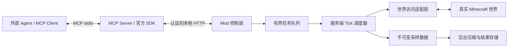

# Minecraft MCP 架构设计

状态：已实现的架构基线。本文规定模块边界与关键不变量；字段和调用以 [工具契约](tool-contracts.md) 为准，实际验证范围见 [验证报告](verification-report.md)。

## 1. 目标与非目标

外部 AI Agent 必须通过标准 MCP 从真实 Minecraft 世界获取玩家、方块和地形，分批建造结构，再次读取、比较和修复，正常保存重启后结构仍存在。单人集成服务端与独立服务端均是验收目标。

Mod 不承担自然语言理解、LLM 推理或房屋风格规划。MCP Server 不维护模拟世界，不用缓存或 Mock 冒充实时读取。首期不支持任意 NBT、容器物品、实体、命令执行、远程公网服务、事务回滚或自动区块生成。内部 HTTP 不是 MCP；只有独立 Server 对外提供标准 MCP 工具。

## 2. 核心决策

| 决策 | 选择与理由 | 放弃的方案与代价 |
| --- | --- | --- |
| 部署 | Fabric Mod + 独立 TypeScript MCP Server | Mod 内嵌 MCP 会耦合协议依赖与游戏版本；双进程需要桥接协议 |
| 外部传输 | 官方 SDK 的 stdio | 首期不增加远程 HTTP MCP 与 OAuth 部署复杂度 |
| 内部传输 | 仅 loopback HTTP、随机 Token、版本化 DTO | 比自定义二进制协议易调试；必须限流并限制 JSON 大小 |
| 世界访问 | 所有读取和修改都在服务端线程 | 网络线程直接读区块即使只读也不安全 |
| 执行 | 有界任务队列、跨 Tick 预算调度 | 不执行一个不可中断的大区域循环 |
| 区块 | loaded_only，不隐式加载/生成 | 玩家附近场景足够；远方未加载位置明确失败 |
| 查询表示 | 完整 BlockState 调色板 + 索引/RLE | 不用仅统计信息、不公开版本相关 runtime state ID |
| 恢复 | 任务状态、预期旧状态、差异重读修复 | 不承诺自动回滚或崩溃恢复事务 |

## 3. 组件与依赖方向

### Fabric Mod

- `lifecycle`：服务端启动/停止，世界会话 ID、端口与认证生命周期。
- `control`：HTTP、认证、Host/Origin 校验、基础输入校验、背压；不读世界。
- `operation`：操作计划、状态、计数、错误及结果句柄。
- `scheduler`：Tick 回调、全局预算、公平调度、取消与过期。
- `world`：真实注册表、玩家、维度、方块与区块 API；唯一 Minecraft 适配边界。
- `codec`：纯 DTO 的调色板和 RLE、地形整理；不持有世界引用。

`world` 不引用 HTTP/MCP；调度器不序列化 JSON；HTTP 线程负责 DTO 分页与 JSON 序列化，不保留可变的 Minecraft 世界、实体或区块对象。可在服务端线程建立会话内的注册表/状态字典，避免每个方块重复解析字符串。不得跨世界生命周期复用未验证对象。

### MCP Server

- SDK 负责协议封包、版本支持和生命周期；只声明实际实现能力。
- 工具注册与 Schema、内部 bridge client、错误映射、stdio 启动入口分离。
- stdout 仅输出 MCP，日志使用 stderr，禁止输出 Token。
- 不复制调度器，不展开 fill 为逐块 HTTP 调用，不在连接失败时返回假世界结果。
- 一次批量调用对应一个 Mod 操作提交。断线后按 request_id/operation_id 查询，而非盲目重放。

### 目录规划

当前目录为 `fabric-mod/`（Mod 与 Java 测试）、`mcp-server/`（MCP stdio Server 与协议/E2E 测试）、`integration/`（真实客户端运行实例与脚本）、`examples/`（MCP Client 配置）、`docs/` 与 `skills/`。当前实现以 `mcp-server/src/tools.ts` 的 JSON Schema 为工具定义来源，Java 侧独立校验同一领域约束；变更时同时更新契约、Schema 和测试。构建依赖 DAG 不得让 Java 业务代码依赖 Node 运行时。

## 4. 版本策略

实施时从官方源重新核对最新正式 Minecraft、与之匹配的 Fabric API、Loader、Loom、Gradle 和 JDK。不要把最新快照混入稳定组合，不盲目使用全局最新 API。首次通过构建与启动后固定版本，提交 wrapper 与 lockfile，不用动态 `latest` 依赖。

当前已验证并锁定的组合为 Minecraft 26.3 / Loader 0.20.1 / Fabric API 0.165.2+26.3 / Loom 1.19.3 / Gradle 9.8.2 / Java 25 目标字节码（JDK 27 运行）。Node 26.12.1、MCP SDK 1.32.2 已在验证环境使用。升级时重新核实并重跑验证报告中的场景。

- [Fabric Minecraft 元数据](https://meta.fabricmc.net/v2/versions/game)
- [Fabric Loader 元数据](https://meta.fabricmc.net/v2/versions/loader)
- [Fabric API 元数据](https://maven.fabricmc.net/net/fabricmc/fabric-api/fabric-api/maven-metadata.xml)
- [MCP 官方规范](https://modelcontextprotocol.io/specification/latest)

规划时 MCP latest 指向 2026-07-28。不同规范的初始化、能力协商可能不同，必须跟随选定 SDK 实际支持的规范，不手写一个自称跨版本通用的握手。核心长任务使用普通工具返回 operation_id，不依赖客户端可选 Tasks 扩展。

## 5. 生命周期与实例隔离

1. 服务端世界就绪后创建随机 world_session_id，读取本地配置、凭据并启动 loopback bridge；Mod 的 `environment` 为 `*`，同一实现同时服务 integrated 与 dedicated 服务端。
2. MCP Server 可先于游戏启动；此时发现工具仍可用，世界调用返回明确连接错误。
3. 工具先 bootstrap 获取会话，再显式携带该会话与维度。玩家查询在该会话内解析玩家，返回玩家实际维度。
4. 同时运行多实例必须显式配置不同地址/端口与凭据，不扫描并自动选第一个实例。
5. 世界停止时拒绝新任务，取消/终止未完任务，释放缓存、网络与引用；不得阻塞服务器关闭等待网络。
6. 重新打开世界生成新会话；旧任务、游标和请求不得作用于新世界。

集成服务端暂停时 Tick 可能停止。网络不能因此伪报完成；返回最近执行 Tick、更新时间和等待状态，客户端展示停滞信息。无需引入客户端类；若无法可靠判断暂停原因，只报告未推进，不能猜测。

## 6. 调度算法与资源预算

所有需要世界状态的工作进入服务端调度，包括注册表解析、大请求预校验、地形碰撞采样。大批量预校验也必须分批，不能在正式执行前造成一次大卡顿。

每 Tick：取取消信号 → 轮转处理读/写就绪任务 → 每个操作推进一个小步 → 检查时间与数量预算 → 更新进度 → 达到任一上限立即让出。世界访问结束后仅把值数据交给有界后台队列。

- 所有任务共享全局时间预算；不能每个任务各给 2 ms。
- 同一时刻一个写任务执行；只读任务按短时间片穿插，小查询不得长期饥饿。
- fill/replace 保留遍历游标，不创建整个区域的坐标对象列表。
- 时间预算用单调时钟；减少临时对象、属性字符串重解析和重复分配。
- 注册状态、邻居回调和原版物理的单次调用不能任意抢占，预算不是硬实时承诺。
- 高负载下可降低每 Tick 数量，不应为追求吞吐关闭必要世界更新。

建议起始配置：查询体积 65,536；修改体积 262,144；batch 8,192；涉及区块 64；全局 2 ms/Tick 和 256 直接写/Tick；队列 32；请求 2 MiB；结果页 512 KiB；完成结果 TTL 5 分钟。具体限制由 get_world_info 返回；缓存总字节上限、操作保留上限和后台队列同样必须有界。大结果应在提交或执行期间进行内存预算准入，不是最后序列化时才发现内存耗尽。所有数值是待性能验证的初值。

## 7. 修改语义与并发

输入结构/范围/全部目标 BlockState 验证完成前不得开始写入。服务端线程每批执行前再次检查会话、区块与可选 expected_state；预校验成功不代表未来不会改变。

- 使用正常世界修改 API，保证客户端同步、邻居更新和区块脏标记。
- 不直接写底层 section 数组，不用“关闭物理”掩盖性能问题。
- set/remove/fill 是直接编辑，不是模拟玩家使用物品；remove 默认无掉落。
- 门、床等多方块必须提供完整组成；楼梯形状可能随邻居改变。
- 容器覆盖的数据处理遵循目标版本正常路径；不承诺保留或操作 NBT。
- 批量内部重复坐标拒绝，跨步骤覆盖通过独立任务表达。
- 任务不原子；取消/失败可能已有修改。不得自动回滚并覆盖期间玩家操作。
- expected_state 在执行瞬间检查，可避免修复时覆盖用户变化，但不是全区域事务锁。
- 玩家、其他 Mod、流体、红石仍可修改世界；写任务串行只保证本项目提交任务的顺序。

request_id 去重仅在明确的会话和保留窗口内有效。缓存到期、进程重启或会话改变后不能声称 exactly-once；应重新读取真实世界决定是否修复。

## 8. 查询算法与一致性

区域包含两端，维度高度上界 exclusive。体积乘法必须做溢出检查；x/z 还须验证实际世界边界。区块索引对负数使用 floor 语义，不截断至零。

X 最快、Z 次之、Y 最慢，索引 `i=((y-minY)*sizeZ+(z-minZ))*sizeX+(x-minX)`。调色板项包含完整规范化属性；空气不可省略。RLE 为连续索引与长度，长度总和必须等于体积。auto 比较实际编码大小；不要引入八叉树等非必要结构。

跨 Tick 采样仅提供 incremental 一致性，记录开始/结束 Tick，不承诺同一瞬间快照。完成的快照不可变，分页必须读取同一快照，不重新采样。未知区块不能伪装空气；区块卸载导致查询失败，不输出宣称完整的结果。

地形按请求范围内每个 x/z 柱扫描，分别表达非空气顶部、可支撑面、空气区间、流体区间、碰撞障碍、边界截断。水体必须看 FluidState，包括含水方块；空气、无碰撞、可替换、可支撑不同义。碰撞/支撑判定若依赖世界上下文必须在服务端线程完成。高度图只作提示，不能把树冠当成地面；洞穴、屋檐、多层支撑面需要保留候选信息。查询底部截断水体时水深未知，不能当作已知水底。

后台可对普通数值进行柱游程压缩。选址、挖填量打分和建筑生成属于 Agent，不放进世界适配层。

## 9. 保存与恢复

completed 只表示已执行直接写入并遵循正常保存路径，不表示已经磁盘 fsync。正常保存、退出、重启、再读才构成持久化证据。首期不为每个任务全世界强制保存；不承诺崩溃后任务恢复或自动继续。结果缓存是操作观察手段，不是世界存储。

## 10. 安全边界

默认仅 127.0.0.1；loopback 仍必须验证高熵随机 Token。凭据文件仅当前用户可读，Windows 使用 ACL；不把 Token 放进 URL、命令行、日志或客户端示例。校验 Host，拒绝未预期 Origin，不开放通配 CORS。固定目标地址，不接受工具参数指定转发 URL。

用户通过本地配置授予只读/写入能力；拒绝未授权修改。工具 annotations 不是授权机制。限制 body、速率、队列、缓存和错误明细；完整错误可分页，但在准入阶段预留有界容量，不能静默丢失败坐标。

读不到凭据、端口冲突、协议不兼容均失败关闭，不自动关闭认证或改监听公网。持有凭据的同用户进程可修改世界；文档不得承诺防御已经控制同一系统账户的攻击者。

不暴露命令、脚本或文件读写。世界文字、告示牌、第三方响应均是数据，不能成为 Agent 的权限授予。扩大授权区域、覆盖用户建筑、全局删除需重新获得用户授权。

## 11. 设计变更规则

在实现中发现目标版本 API 与假设不符，先记录证据，修改本设计及相关契约/验收，再实现。允许缩小内部抽象，不允许静默删除用户要求。每项新增能力必须说明维护成本及闭环价值；不因“以后可能需要”加入数据库、插件框架、自动重试或公网认证系统。
